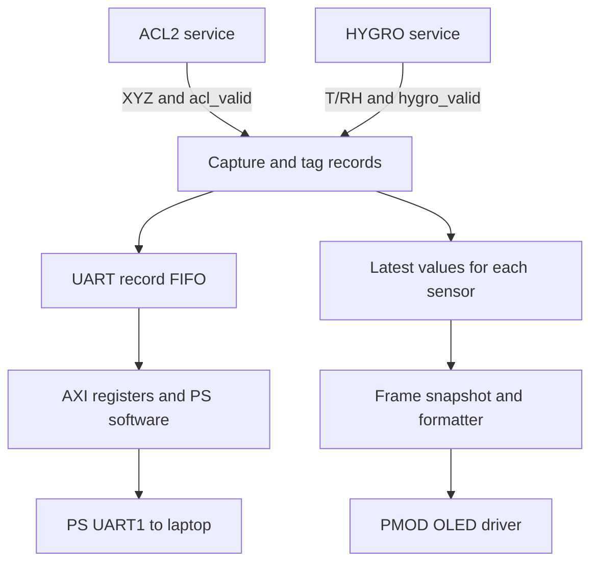

# Sensor acquisition and shared outputs

## What is implemented now

sensor_hub.sv connects the real ACL2 and HYGRO service modules to one priority
arbiter with aging. Channel 0 is ACL2; channel 1 is HYGRO. The hub exposes
raw values and one-clock valid strobes. It does not yet contain output queues,
UART, OLED, an AXI bridge, or final board wiring.

The sensors do not send data to each other. ACL2 provides signed X/Y/Z
acceleration over SPI and requests service after a data-ready interrupt.
HYGRO provides unsigned raw temperature/humidity over I2C; its controller
requests timed acquisitions because HYGRO has no data-ready pin.

Their physical buses are separate. The arbiter deliberately schedules whole
sensor transactions for the project's priority/fairness experiment. It is
not an electrical I2C multi-master arbiter. Although these separate physical
buses could operate concurrently, the present design serializes service.

Both requesters assert req; the arbiter grants one according to priority and
aging. The selected requester retains ownership until its one-cycle done.
No SPI or I2C frame is preempted. Aging helps a waiting requester win later;
it does not interrupt an already-running transaction.

A HYGRO measurement uses two separately granted transactions:

1. Grant HYGRO to send the conversion trigger.
2. HYGRO asserts done and releases its grant.
3. During the 20 ms conversion wait, an ACL2 interrupt can request and receive
   a grant, complete its SPI burst, and publish XYZ.
4. HYGRO requests a new grant to read its completed temperature/humidity pair.

The existing tb_sensor_hub checks this interaction. Test HYGRO alone using
hygro_test_top with channel 0 tied idle. For final integration instantiate
sensor_hub instead of connecting both standalone board tops, which each have
an arbiter and LED output driver of their own.

## Intended output path — still to implement



Output capture must be independent of the next acquisition. sample_valid is
only one clock; output drivers must not wait until they are idle to capture it.
Use separate storage for UART logging and display values, so OLED refresh
cannot consume or block UART's records. A single FIFO popped alternately by
UART and OLED would split the data between outputs instead of delivering it
to both.

config_pkg.sv already defines a 256-bit sensor_record_t with source ID,
sequence number, timestamps, values and arbitration wait. This is a proposed
record contract; the current hub does not construct these records. The
record-building module must populate the metadata and zero fields belonging
to the other source. Its error/status encoding must be defined explicitly:
HYGRO's local error_code is not numerically identical to config_pkg.error_t.

Suggested modules and responsibilities:

| Planned file | Responsibility |
|---|---|
| rtl/output/record_fanout.sv | Capture each valid pair/XYZ, tag source and sequence, enqueue logging record and update display cache |
| rtl/output/uart_record_mux.sv | Select complete records fairly if separate per-source queues are used; never interleave characters from two records |
| rtl/output/oled_update_mux.sv | Own the shared frame snapshot; include values from both sources |
| rtl/output/value_format.sv | Convert raw measurements into fixed-width text/numbers |
| rtl/output/oled_driver.sv | PMOD OLED initialization, power sequence and SPI commands/data |
| rtl/output/font_rom.sv and assets/font8x8.mem | Text glyph data |
| rtl/axi/axi_regs.sv | Expose queued records/status to the processing system |
| sw/main.c and sw/pl_irq.c | Receive PL notification, drain records and transmit using PS UART1 |
| rtl/metrics/metrics.sv | Capture request-to-grant latency, service counts and overflow counts |
| sim/tb_output_path.sv | Check slow consumers, burst traffic, record ordering and independent destinations |

These are planned files, not implemented modules in this change.

## UART: one complete record at a time

UART is the laptop log. Example text formats (illustrative only):

```
ACL2,seq=42,x=-123,y=456,z=1000
HYGRO,seq=7,temp_C=26.06,rh_pct=50.00
```

A formatter/PS routine must finish one line before starting another. Bounded
FIFOs absorb bursts; if sustained traffic exceeds throughput, count and report
overflows rather than silently dropping data. At 115200 baud with 8N1 framing,
the theoretical budget is 11520 bytes/second, including delimiters and newline.
An 80-byte line at 100 samples/second consumes 8000 bytes/second. Final line
lengths and rates must be budgeted together with both sources and metadata.

The ZedBoard onboard USB-UART bridge is connected to PS UART1 on MIO48/49.
Therefore using that connector requires a Zynq PS design plus a PL-to-PS
interface and software. A uart_tx module in PL cannot simply be assigned to
those MIO pins with an XDC. An alternative is a PL UART on a spare PL PMOD pin
with an external 3.3 V USB-UART adapter; that is a different hardware route.
No PS software is needed for the current standalone HYGRO LED test.

## OLED: shared snapshot, one owner

The display should show the newest available values from both sensors. ACL2
may update much faster than HYGRO. Retain one latest-value set per source and
refresh at a modest configured rate, e.g. 5 frames/second. At frame start,
snapshot both sets so values do not change halfway through drawing a frame.
Include source-valid/fault or stale indicators; zero before the first sample
must not be displayed as a valid measured zero.

Illustrative display layout:

```
T:26.06C RH:50.0%
X: -123
Y:  456
Z: 1000
```

A single renderer owns the display. Neither sensor controller writes directly
to it. The OLED cache may coalesce intermediate updates intentionally; the UART
log should retain queued records until consumed, subject to explicit overflow
policy. This difference is appropriate because a display shows current state
while a log records history.

Use the PMOD OLED specified in the project, not ZedBoard's onboard OLED pin
mapping. Give its driver separate SPI pins/engine so a display frame does not
hold the acquisition arbiter. Final connector assignment and PMOD OLED timing
must be checked before its board top and constraints are added.

## Integration order and ownership

1. Person A validates ACL2 hardware; Person B validates HYGRO on JB.
2. Run the existing combined sensor_hub test and preserve the common handshake.
3. Implement record capture, independent UART FIFO and OLED latest-value cache.
4. Verify both outputs with deliberately stalled consumers and overflow tests.
5. Add AXI/PS UART and PMOD OLED hardware drivers, then the final board top/XDC.
6. Measure fairness and latency with aging enabled/disabled under the same load.

For a HYGRO result record, define latency as the result-read request-to-grant
wait; measure trigger transaction latency separately if needed. Conversion
time is sensor latency, not arbitration wait. Grant counts alone do not show
fairness when request rates and transaction durations differ; include waiting
latency, service counts, offered load and any dropped/coalesced samples.

Reference for onboard UART wiring:
https://files.digilent.com/resources/programmable-logic/zedboard/ZedBoard_HW_UG_v2_2.pdf
